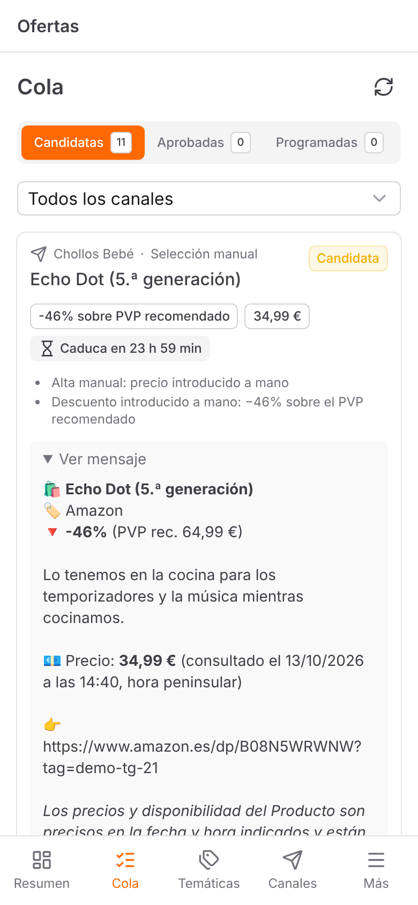
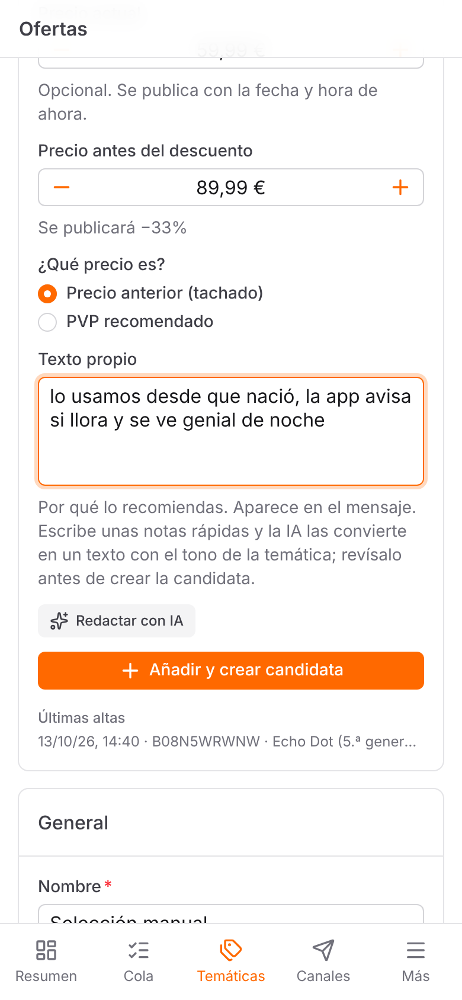
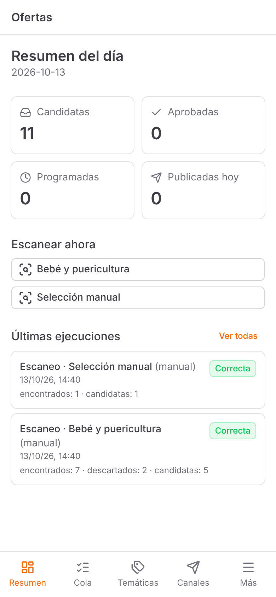
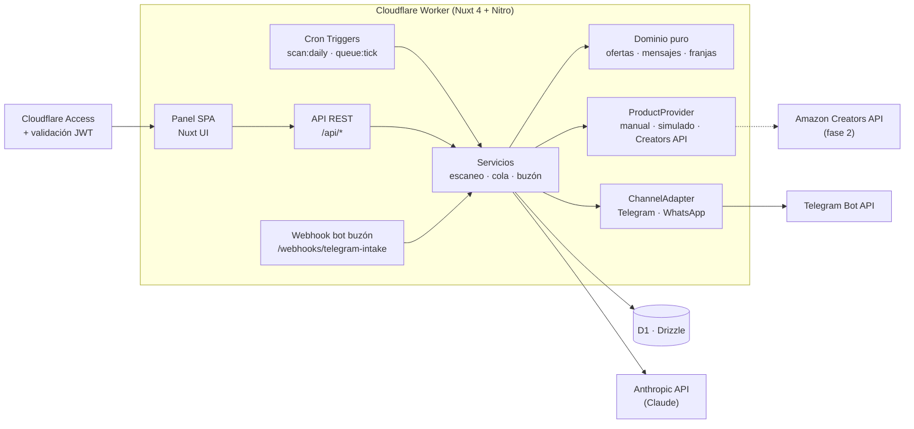

# Ofertas · gestor de canales de afiliados de Amazon

Herramienta que detecta ofertas de **Amazon.es** por temáticas configurables, prepara los mensajes con enlace de afiliado y gestiona su publicación en **Telegram** (automática) y **WhatsApp** (asistida). El panel está en español y pensado para usarse desde el móvil.

> *English summary:* a mobile-first back office to run Amazon affiliate deal channels on Telegram and WhatsApp. It finds deals, filters out inflated discounts, writes on-brand copy with Claude, and schedules or publishes posts. It runs on a single Cloudflare Worker (Nuxt 4, Nitro, D1, Cron Triggers) and is designed around Amazon Associates policy compliance.

<p align="center">
  
  
  
</p>

## Qué hace

1. **Detecta ofertas** por temática (palabras clave, categorías, exclusiones y filtros de precio, valoración y descuento mínimo).
   - Descarta descuentos poco fiables, como los calculados sobre un PVP recomendado inflado.
   - Evita repetir el mismo producto dentro de una ventana de días.
2. **Prepara el mensaje** de cada canal con su propio tracking ID, plantillas por formato (HTML de Telegram o texto de WhatsApp) y los avisos legales obligatorios.
   - Una **entradilla redactada con IA** (Claude) en el tono de la temática.
   - Un **texto propio** que la IA amplía a partir de unas notas.
3. **Gestiona una cola** de candidatas: revisar, editar, aprobar, programar en el siguiente ciclo del cron, publicar o descartar. Las candidatas caducan a las 24 h.
4. **Publica:**
   - en **Telegram**, automáticamente vía Bot API;
   - en **WhatsApp**, de forma asistida: se comparte desde el móvil, porque no hay API oficial para Canales.
5. **Bot buzón:** se comparte un producto desde la app de Amazon a un bot de Telegram, que lo da de alta, crea la candidata y permite publicarla desde el chat.

## Arquitectura



- **Un solo Worker** sirve el panel, la API, el webhook del bot y las tareas programadas. No hay servidores que mantener y el coste es prácticamente cero con el volumen previsto.
- **Lógica de negocio pura y testeada** en `server/domain`: evaluación de ofertas, deduplicación, plantillas, estados de publicación y franjas horarias. No tiene E/S, así que se prueba sin mocks.
- **Puertos y adaptadores:** `ProductProvider` y `ChannelAdapter` aíslan Amazon y las redes. Cambiar el proveedor simulado por la Creators API no toca el dominio.

Más detalle en [`docs/arquitectura.md`](docs/arquitectura.md).

## Decisiones técnicas destacadas

- **Cumplimiento de las normas de Afiliados como requisito de diseño.** Antes de escribir código se analizaron la Licencia y las Políticas de Amazon ([`docs/creators-api.md`](docs/creators-api.md)). De ahí salen varias reglas:
  - sin scraping;
  - sin almacenar imágenes (la vista previa la genera cada red a partir del enlace);
  - precio siempre con fecha y hora de consulta y descargo legal;
  - purga de los datos de producto a las 24 h;
  - un tracking ID por canal.

  Cada decisión está registrada en [`SPEC.md`](SPEC.md) §13–14.
- **IA con salvaguardas.** Claude solo redacta texto propio, nunca describe ni reescribe contenido de Amazon (la Licencia lo prohíbe). Cada texto se valida antes de usarse:
  - sin cifras ni precios inventados;
  - sin enlaces ni formato;
  - sin afirmaciones de «mínimo histórico» o envío;
  - sin repetir el título.

  Si la IA falla o el texto no pasa la validación, el mensaje sale solo con la plantilla.
- **Detección de descuentos inflados.** El descuento se clasifica según su referencia:
  - precio anterior real;
  - PVP recomendado;
  - histórico externo.

  Si la referencia es el PVP recomendado y el porcentaje es muy alto, se marca como sospechoso.
- **Programación honesta.** La hora programada se alinea con el ciclo real del cron (cada 10 min). El panel muestra la hora real de publicación, no la pedida. Un test comprueba que el ciclo coincide con la configuración de `wrangler.jsonc`.
- **Seguridad:**
  - el panel va detrás de Cloudflare Access y la API valida además el JWT y el email autorizado;
  - el webhook del bot se autentica con el token secreto de Telegram, comparado en tiempo constante;
  - la resolución de enlaces cortos sigue solo las redirecciones y nunca descarga páginas de Amazon;
  - los secretos solo se guardan como secretos de Wrangler.
- **Proceso.** Primero la especificación (SPEC con riesgos y decisiones), luego fases incrementales con TypeScript estricto, validación con zod compartida entre panel y API, y tests de la lógica de negocio con Vitest.

## Stack

| Capa | Tecnología |
|---|---|
| Frontend | Nuxt 4 (SPA), Nuxt UI 4, Tailwind; mobile-first |
| Backend | Nitro (preset `cloudflare_module`) en Cloudflare Workers |
| Datos | Cloudflare D1 (SQLite) con Drizzle ORM y migraciones SQL |
| Tareas | Cron Triggers enlazados a tareas Nitro |
| IA | Anthropic API (Claude) con el SDK oficial |
| Auth | Cloudflare Access + validación del JWT con `jose` |
| Calidad | TypeScript estricto, zod, Vitest |

| Cron (UTC) | Tarea | Qué hace |
|---|---|---|
| `0 5 * * *` | `scan:daily` | Escanea todas las temáticas activas |
| `*/10 * * * *` | `queue:tick` | Publica lo programado, caduca a las 24 h y purga datos de producto |

## Estado

- **Fase 1 (MVP):** completada y desplegada.
  - Fuentes: alta manual y proveedor simulado.
  - Publicación en Telegram y WhatsApp asistido.
  - Redacción con IA.
  - Bot buzón.
- **Fase 2:** integración con la Creators API de Amazon (pendiente de acceso a la API) y estadísticas.
- **Fase 3:** posible versión SaaS, condicionada a validar la idea ([`SPEC.md`](SPEC.md) §12).

Documentación: [`SPEC.md`](SPEC.md) (requisitos, riesgos y decisiones) · [`docs/arquitectura.md`](docs/arquitectura.md) (arquitectura y modelo de datos) · [`docs/creators-api.md`](docs/creators-api.md) (Creators API y normas de Afiliados).

---

# Guía de instalación y despliegue

## Puesta en marcha local

Requisitos: Node 22 y pnpm 10 (`corepack enable`).

```bash
pnpm install
cp .dev.vars.example .dev.vars        # AUTH_DISABLED=true para desarrollo
pnpm db:migrate:local                 # crea la D1 local en .wrangler/
pnpm dev                              # http://localhost:3000
```

`nuxt dev` emula los bindings de Cloudflare (D1, variables de `.dev.vars`) mediante wrangler.

Primeros pasos en el panel:
1. **Canales → Nuevo**: crea un canal de Telegram o WhatsApp con su tracking ID.
2. **Temáticas → Nueva**: elige «Simulado (desarrollo)» o «Alta manual» y asígnale canales.
3. **Resumen → Escanear ahora**, o, en una temática manual, **Añadir y crear candidata**. Con «Precio actual» y «Precio antes del descuento» se publica el descuento. Si escribes unas notas en «Texto propio», **Redactar con IA** las convierte en un texto con el tono de la temática.
4. **Cola**: revisa, edita, aprueba, programa o publica.

### Comandos

| Comando | Qué hace |
|---|---|
| `pnpm dev` | Servidor de desarrollo |
| `pnpm test` | Tests unitarios (lógica de negocio, mappers, adaptador de Telegram) |
| `pnpm typecheck` | Comprobación de tipos (app y servidor) |
| `pnpm build` | Build para Cloudflare Workers en `.output/` |
| `pnpm db:generate` | Genera una migración a partir de `server/db/schema.ts` |
| `pnpm db:migrate:local` / `db:migrate:remote` | Aplica las migraciones en D1 local o remota |
| `pnpm run deploy` | Build y `wrangler deploy` (`pnpm deploy` a secas es otro comando de pnpm) |

### Probar el cron en local

```bash
pnpm build
pnpm exec wrangler dev --test-scheduled
curl "http://localhost:8787/__scheduled?cron=0+5+*+*+*"       # escaneo diario
curl "http://localhost:8787/__scheduled?cron=*/10+*+*+*+*"    # procesar cola
```

Las ejecuciones aparecen en **Más → Ejecuciones**, que también permite lanzarlas a mano. Con `wrangler dev` la API exige Cloudflare Access, igual que en producción: usa `pnpm dev` para el panel.

## Variables de entorno

| Variable | Tipo | Descripción |
|---|---|---|
| `DB` | binding D1 | Base de datos (en `wrangler.jsonc`) |
| `TIMEZONE` | var | Zona horaria de las franjas y fechas. Por defecto `Europe/Madrid` |
| `AUTH_TEAM_DOMAIN` | secreto | Dominio del equipo de Cloudflare Zero Trust, p. ej. `mi-equipo.cloudflareaccess.com` |
| `AUTH_AUDIENCE` | secreto | *Application Audience (AUD) Tag* de la aplicación de Access |
| `AUTH_ALLOWED_EMAILS` | secreto | Emails autorizados, separados por comas |
| `TELEGRAM_BOT_TOKEN` | secreto | Token del bot de Telegram |
| `ANTHROPIC_API_KEY` | secreto | Opcional. Activa la entradilla redactada por IA (SPEC §14.6) y el botón «Redactar con IA» del alta manual (§14.9); sin ella, solo plantilla |
| `AUTH_DISABLED` | solo local | `true` desactiva la autenticación. **Solo se respeta en `nuxt dev`** |

En local van en `.dev.vars` (ignorado por git). En producción se configuran con `wrangler secret put NOMBRE`. **Nunca se guardan secretos en el repositorio.**

## Despliegue en Cloudflare

1. **Base de datos**
   ```bash
   pnpm exec wrangler login
   pnpm exec wrangler d1 create affiliates-manager
   ```
   Copia el `database_id` en `wrangler.jsonc` y aplica las migraciones:
   ```bash
   pnpm db:migrate:remote
   ```
2. **Despliegue inicial** (sin secretos de Access, la API responde 500 «Autenticación no configurada»):
   ```bash
   pnpm run deploy
   ```
3. **Cloudflare Access.** Dashboard → Workers & Pages → `affiliates-manager` → Settings → Domains & Routes → en `workers.dev`, **Enable Cloudflare Access**.
   - El aviso que aparece muestra el **AUD** (`POLICY_AUD`) y el **dominio del equipo** (`TEAM_DOMAIN`): guárdalos.
   - En **Manage Cloudflare Access**, deja la política de la aplicación solo con tu email.
   - Las Preview URLs están desactivadas (`preview_urls: false`) porque no quedarían protegidas.
4. **Secretos**
   ```bash
   pnpm exec wrangler secret put AUTH_TEAM_DOMAIN
   pnpm exec wrangler secret put AUTH_AUDIENCE
   pnpm exec wrangler secret put AUTH_ALLOWED_EMAILS
   pnpm exec wrangler secret put TELEGRAM_BOT_TOKEN
   pnpm exec wrangler secret put ANTHROPIC_API_KEY   # opcional
   ```
   No hace falta volver a desplegar: los secretos se aplican al momento. Los Cron Triggers se registran a partir de `triggers.crons` en `wrangler.jsonc`.
5. **Comprobación**: abre la URL en una ventana privada. Debe pedirte el login de Access y, después, cargar el panel; en el panel, **Ajustes** debe mostrar «Cloudflare Access». Sin sesión, `curl https://…workers.dev/api/me` debe devolver la redirección al login de Access, no datos.

### Telegram

1. Crea el bot con [@BotFather](https://t.me/BotFather) y guarda el token como secreto.
2. Añade el bot como **administrador** del canal, con permiso para publicar.
3. En el panel, crea el canal con `@nombre_del_canal` (o el id `-100…`) y pulsa **Verificar bot**.

### Bot buzón (enviar ofertas desde el móvil)

Un **bot aparte** del que publica. Compartís un producto desde la app de Amazon (**Compartir → Telegram → el bot**) y:

1. El bot saca el ASIN del enlace. Los enlaces cortos `amzn.eu` se resuelven siguiendo solo la redirección; nunca se abre la página del producto.
2. Responde con una tarjeta. **Respondiendo a ella** podéis añadir:
   - el precio (`19,99`), que se publica con la fecha y hora del alta (SPEC §14.7, modo de validación hasta tener la Creators API);
   - el título (`t: …`), si no venía en el texto compartido;
   - un comentario (cualquier otro texto).
3. Elegís la temática (solo las de fuente «Alta manual»). Se crea la candidata en cada canal con la entradilla de IA.
4. Desde la misma tarjeta:
   - Telegram: 🚀 publicar, ⏰ próximo ciclo o 🗑️ descartar.
   - WhatsApp: 📋 recibir el texto, ✅ marcar como hecho o 🗑️ descartar.

Configuración:
1. Crea el bot con [@BotFather](https://t.me/BotFather) (`/newbot`) y, en `/setjoingroups`, desactiva que lo añadan a grupos.
2. Secretos:
   ```bash
   pnpm exec wrangler secret put INTAKE_BOT_TOKEN          # token del bot buzón
   pnpm exec wrangler secret put INTAKE_WEBHOOK_SECRET     # cadena aleatoria, p. ej. `openssl rand -hex 32`
   pnpm exec wrangler secret put INTAKE_ALLOWED_USER_IDS   # vuestros IDs de Telegram: 111111111,222222222
   ```
   Para saber vuestro ID, escribid al bot: si no estáis autorizados, os lo dice.
3. **Cloudflare Access debe dejar pasar al webhook**, porque Telegram no puede iniciar sesión.
   - En Zero Trust → Access → Applications, crea una aplicación *Self-hosted* con el mismo dominio y la ruta `webhooks/telegram-intake`.
   - Ponle una política con acción **Bypass** e *Include: Everyone*.
   - La ruta sigue protegida por el token secreto que Telegram envía en cada petición.
4. En el panel, **Ajustes → Bot buzón → Conectar webhook**.
5. Para que tu pareja use también el panel, añade su email a la política de Access y a `AUTH_ALLOWED_EMAILS`.

### WhatsApp (publicación asistida)

La API oficial no permite publicar en Canales de WhatsApp, y las librerías no oficiales arriesgan el baneo del número, así que no se usan. En la cola, **Compartir en WhatsApp**:
1. recomprueba el precio;
2. abre el menú de compartir del móvil (o permite copiar el texto);
3. cuando hayas publicado, márcalo con **Ya lo he publicado**.

WhatsApp genera la vista previa a partir del enlace.

### Amazon Afiliados

- Crea un **tracking ID distinto por canal** en Associates Central y da de alta cada canal como «Sitio».
- Los mensajes incluyen siempre el aviso de afiliado. Si llevan precio, incluyen también la fecha y hora de consulta y el descargo exigido por la Licencia (ver `docs/creators-api.md` §7).

## Estructura

```
app/              Panel (páginas, componentes, composables)
shared/           Tipos y validaciones (zod) comunes a panel y API
server/
  domain/         Lógica de negocio pura (ofertas, deduplicación, mensajes, estados, franjas)
  providers/      ProductProvider: manual, simulado, Creators API (fase 2) e histórico (Keepa, pendiente)
  channels/       ChannelAdapter: Telegram (automático) y WhatsApp (asistido)
  services/       Orquestación con E/S: escaneo, cola, plantillas, ejecuciones
  api/            Endpoints REST del panel
  tasks/          Tareas Nitro del cron
  db/             Esquema Drizzle y migraciones
tests/            Vitest
```

## Licencia

© 2026 Hugo Bermúdez. Todos los derechos reservados.

El código se publica como portfolio para que pueda consultarse. No se concede licencia de uso, copia, modificación ni distribución sin permiso expreso del autor.
